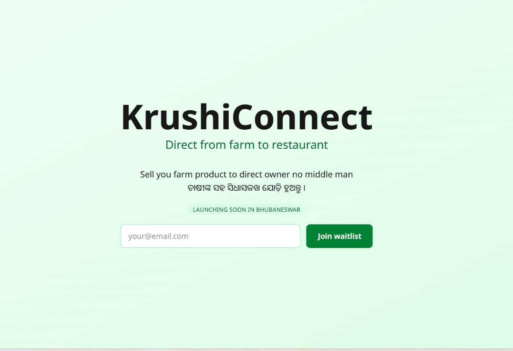

# KrushiConnect

It is a platform where a farmer direct sell product to hotels or restaurant.

[Live Demo](https://krushi-connect-psi.vercel.app/)



## Current status (v0.1)

- You can give you add your email if you are interested.

## Tech Stack

Built with NextJS.

## Roadmap:

Week 18: landing page. Week 19: auth. Week 20: farmer listing. Week 21: buyer browse...

## What I Learned

I learn how to write a minimum MVP for a product. And useActionState for error or success message from the server action.

## How to Run It Locally

```bash
git clone https://github.com/Anshuman56/krushi-connect
cd krushi-connect
npm install
create a .env.local file with you mongodb database connection.
npm run dev
```
